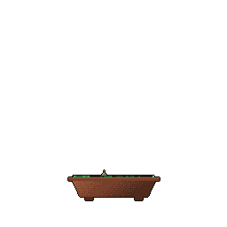

# Marsim

<table>
  <tr>
    <td width="65%" valign="middle">

Game developer from Malta with a Bachelor's degree in Digital Games Development from MCAST.

Interested in gameplay systems, unconventional gameplay mechanics, and TTRPGs.

[Portfolio](https://marsim.net) · [itch.io](https://marsim.itch.io) · [LinkedIn](https://www.linkedin.com/in/lydon-camilleri/)

   </td>
   <td width="35%" align="center" valign="middle">
     
   </td>
  </tr>
</table>

### Tools

