# Marsim

Game developer from Malta, studying Digital Games Development at MCAST.  
Interested in gameplay systems, procedural generation, and TTRPGs.

[Portfolio](https://marsim.net) · [itch.io](https://marsim.itch.io) · [LinkedIn](https://www.linkedin.com/in/lydon-camilleri/)

### Tools

### Projects

- **[Unreal Dice Dungeon](https://github.com/Marsimio/UnrealDiceDungeon)** — First-person slasher with procedurally generated dungeons.
- **[Bookworm](https://github.com/Marsimio/DGD-2D-Bookworm)** — Unity dungeon crawler with interacting spells.
- **[Dice Game](https://github.com/Marsimio/DGD-3D-DiceGame)** — Unity combat project with skill trees and a shop.

Unity Certified Associate — Game Developer · 2023

